# lab-exam-agent

Transpilador que transforma uma especificação JSON em um agente **Google ADK 2**.

O agente de exemplo lê a foto de um pedido médico, extrai os exames, encontra os códigos no catálogo e registra o agendamento numa API.

## Tecnologias

| Parte | Tecnologias |
|---|---|
| Transpilador | Python 3.12, Pydantic, Jinja2 |
| Agente | Google ADK 2 (Workflow, JoinNode, RequestInput), Gemini |
| OCR | MCP via SSE, Tesseract, OpenCV |
| RAG | MCP via SSE, BM25, RapidFuzz |
| API | FastAPI, PostgreSQL, SQLAlchemy, Alembic |
| Infra | Docker Compose |
| Observabilidade | OpenTelemetry, Aspire Dashboard |
| Qualidade | pytest, Ruff, mypy, import-linter, GitHub Actions |

## Como rodar

### Requisitos

| Item | Versão |
|---|---|
| Docker | Docker Desktop (Windows, macOS) ou Docker Engine (Linux) |
| Docker Compose | 2.24 ou mais novo |
| Chave do Gemini | [aistudio.google.com/apikey](https://aistudio.google.com/apikey) |
| Python e uv (só para desenvolvimento) | Python 3.12, uv 0.12 ou mais novo |

Para rodar não é preciso Python, uv nem make: só Docker.

### Comandos

```bash
cp .env.example .env         
# preencha GOOGLE_API_KEY no .env

docker compose up -d --build --wait
docker compose run --rm transpile /app/agent_specs/exam_scheduling_agent.json
docker compose run --rm agent run --agent exam_scheduling_agent --image /app/inputs/samples/pedido_medico_ficticio.png
```

| Cenário | Comando |
|---|---|
| Revisão humana | `docker compose run --rm agent run --image /app/inputs/samples/pedido_ambiguo.png` |
| Prompt injection | `docker compose run --rm agent run --image /app/inputs/samples/pedido_injecao.png` |
| Gerar a spec alternativa | `docker compose run --rm transpile /app/agent_specs/examples/exam_lookup_only.json` |
| Rodar a spec alternativa | `docker compose run --rm agent run --agent exam_lookup_only --image /app/inputs/samples/pedido_medico_ficticio.png` |
| Ver o código gerado | `docker compose run --rm export-generated` |
| Swagger | http://localhost:8000/docs (Authorize com `SCHEDULER_API_KEY`) |
| Desligar tudo | `docker compose --profile "*" down -v` |

### Escolher o agente

O transpilador gera um agente por spec. Para gerar e rodar cada um:

```bash
# Agente principal
docker compose run --rm transpile /app/agent_specs/exam_scheduling_agent.json
docker compose run --rm agent run --agent exam_scheduling_agent --image /app/inputs/samples/pedido_medico_ficticio.png

# Agente alternativo
docker compose run --rm transpile /app/agent_specs/examples/exam_lookup_only.json
docker compose run --rm agent run --agent exam_lookup_only --image /app/inputs/samples/pedido_medico_ficticio.png

# Listar os agentes gerados
docker compose run --rm agent list
```

Sem `--agent`, roda o agente principal (`exam_scheduling_agent`).

O código gerado fica num volume do Docker, não na pasta do projeto. Para copiá-lo para `./generated/`:

```bash
docker compose run --rm export-generated
```

Ele fica no volume porque, dentro do container, o transpilador roda com um usuário sem privilégios. Se gravasse direto na pasta do projeto, no Linux daria erro de permissão ou deixaria arquivos que só se apagam com `sudo`.

## Arquitetura

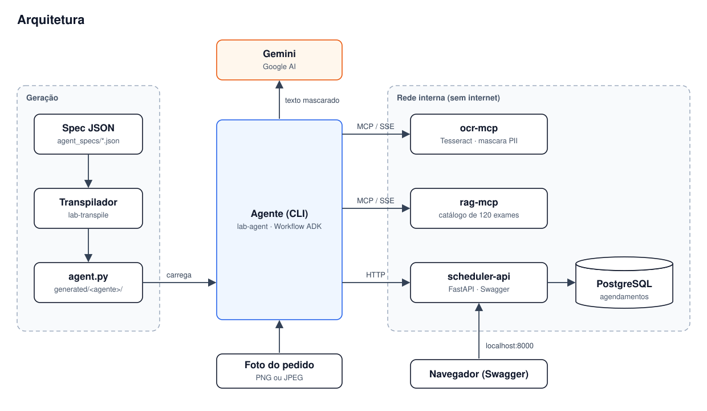

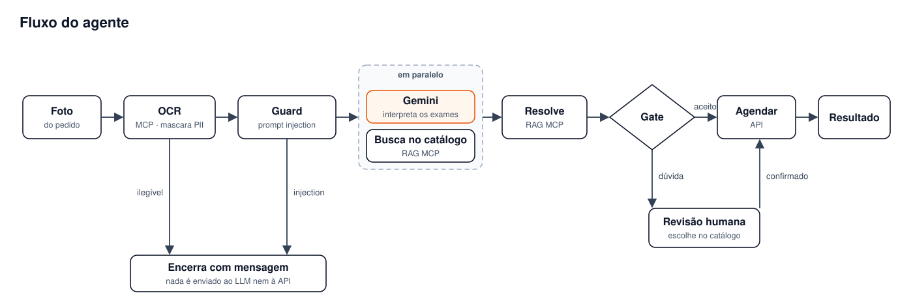

- **A IA interpreta, o código decide.** O Gemini só lê o texto mascarado; quem escolhe o código e agenda é o gate.
- **OCR e RAG são servidores MCP via SSE**, chamados por nós de código, nunca pelo LLM.
- **Workflow em grafo (ADK 2):** sequencial, com fan-out/join paralelo e human-in-the-loop. Equivale a `SequentialAgent` + `ParallelAgent` do ADK 1.

### Estrutura de pastas

```text
.github/workflows/       CI: lint, tipos, testes e E2E
src/
├── transpiler/          spec JSON → validação → geração do agente ADK
├── agent_runtime/       nós do workflow, guardrails e CLI
├── libs/
│   ├── pii_guard/       detecção e mascaramento de dados pessoais
│   └── lab_common/      regra do gate, contratos, logs
└── services/
    ├── ocr_mcp/         servidor MCP de OCR
    ├── rag_mcp/         servidor MCP de busca no catálogo
    └── scheduler_api/   API de agendamento (FastAPI)
agent_specs/             specs dos agentes e o schema do formato
data/                    catálogo de exames
samples/                 imagens de pedidos fictícios
tests/                   unit, contract, integration, security, e2e
docs/                    ADRs
docker/                  Dockerfiles
evidence/                prints e logs de execução
```

## Transpilador

```text
JSON → validação → representação interna → geração (Jinja2) → validação do código → pacote
```

- Mostra todos os erros de uma vez, com o caminho exato na spec.
- Recusa agentes inseguros (por exemplo, agendar sem passar pelo gate).
- A mesma spec gera sempre o mesmo código.

| Spec | Gera |
|---|---|
| [`exam_scheduling_agent.json`](agent_specs/exam_scheduling_agent.json) | Fluxo completo: LLM, revisão humana e agendamento |
| [`examples/exam_lookup_only.json`](agent_specs/examples/exam_lookup_only.json) | Só identifica os exames, sem LLM nem agendamento |
| [`examples/exam_validation_errors.json`](agent_specs/examples/exam_validation_errors.json) | Spec inválida de propósito, para ver os erros |

```bash
# Gerar outro agente e rodá-lo pelo nome
docker compose run --rm transpile /app/agent_specs/examples/exam_lookup_only.json
docker compose run --rm agent run --agent exam_lookup_only --image /app/inputs/samples/pedido_medico_ficticio.png

# Ver os erros de uma spec inválida, sem gerar nada
docker compose run --rm --entrypoint lab-transpile transpile validate /app/agent_specs/examples/exam_validation_errors.json
```

## API

| Rota | O que faz |
|---|---|
| `POST /v1/appointments` | Registra um agendamento (idempotente) |
| `GET /v1/appointments` | Lista os agendamentos |
| `GET /v1/appointments/{id}` | Consulta um agendamento |
| `GET /v1/exams/{code}` | Consulta um exame do catálogo |

## Segurança

- **Dados pessoais** mascarados no OCR e checados de novo antes do LLM e nos logs. A API só recebe um pseudônimo.
- **Prompt injection** bloqueado antes do LLM, que não tem ferramentas.
- **Códigos de exame** vêm só do catálogo.
- **Containers** sem root, só leitura e numa rede interna sem internet.

## Logs e traces

```bash
docker compose --profile observability up -d --build --wait
```

Abra http://localhost:18888 e procure pelo `run_id` que a CLI mostra no final.

## Testes

```bash
uv sync --all-extras --group dev
uv run pytest -m "unit or contract"
uv run pytest -m "e2e and not llm" tests/e2e
```

Mais de 2.000 testes, com 98% de cobertura.

## Decisões de arquitetura

| ADR | Decisão |
|---|---|
| [0001](docs/adr/0001-workflow-em-grafo-adk.md) | Workflow em grafo; LLM num único nó |
| [0002](docs/adr/0002-codigo-gerado-como-composicao.md) | Código gerado só compõe peças testadas |
| [0003](docs/adr/0003-pii-mascarada-na-origem.md) | PII mascarada no servidor de OCR |
| [0004](docs/adr/0004-mcp-chamado-por-nos-deterministicos.md) | MCP chamado por código, não pelo LLM |
| [0005](docs/adr/0005-rag-lexico-hibrido.md) | Busca léxica híbrida, calibrada |
| [0006](docs/adr/0006-idempotencia-por-chave-deterministica.md) | Idempotência por chave derivada do conteúdo |
| [0007](docs/adr/0007-sse-como-transporte-mcp.md) | SSE como transporte MCP |
| [0008](docs/adr/0008-ocr-local-tesseract.md) | OCR local com Tesseract |
| [0009](docs/adr/0009-adk-api-contract.md) | Contrato com a API do ADK 2.13.0 |

## Evidências

Prints de execução real, gerados com os comandos deste README.

| Área | O que mostra |
|---|---|
| [Transpilador](#transpilador-1) | Geração do agente, erros de validação e lista de agentes |
| [Agente (CLI)](#agente-cli) | Fluxo completo, idempotência, revisão humana, prompt injection e pedido manuscrito |
| [API](#api-1) | Swagger e consulta dos agendamentos registrados |
| [Logs e traces](#logs-e-traces-1) | Logs estruturados e trace de uma execução no Aspire |
| [Docker](#docker) | Serviços do Compose no ar |
| [Testes](#testes-1) | Suíte de testes e cobertura |

### Transpilador

**Geração do agente a partir da spec.** O transpilador lê `exam_scheduling_agent.json` e gera `agent.py`, `__init__.py` e `_manifest.json`.

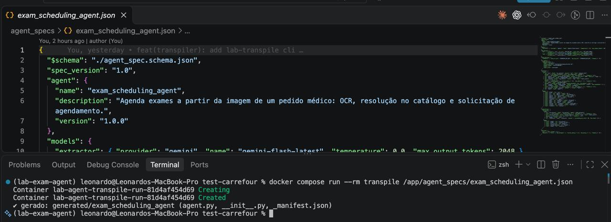

**Spec inválida.** Os quatro erros aparecem de uma vez, cada um com código, caminho na spec e dica de correção. Nenhum arquivo é gerado.

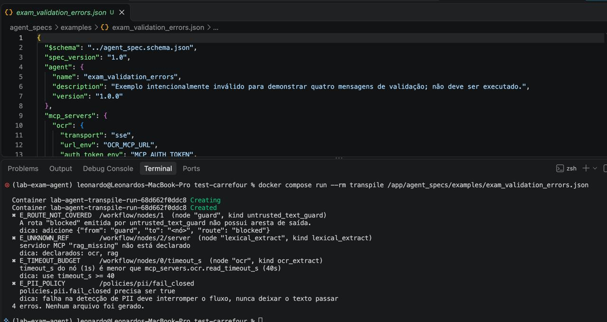

**Agentes gerados.** `agent list` mostra os dois agentes disponíveis para `--agent`.

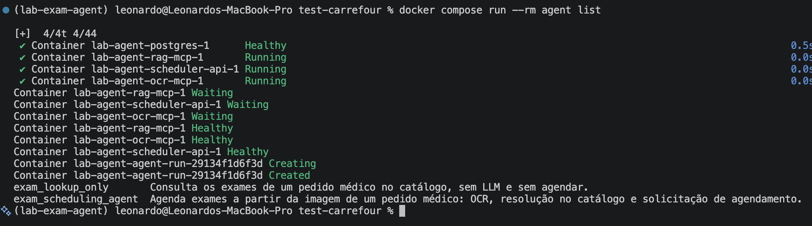

### Agente (CLI)

**Fluxo completo.** Pedido digitado: 7 exames agendados, 8 dados pessoais mascarados. "PCR" e "Urina tipo 1 (EAS)" foram resolvidos para os nomes do catálogo.

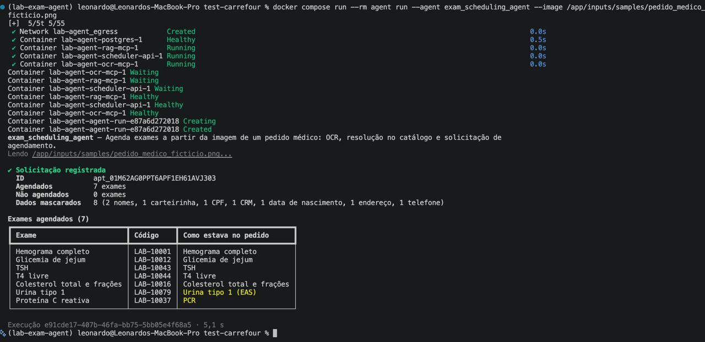

**Idempotência.** A mesma imagem rodada de novo devolve o mesmo `ID` e nada é duplicado.

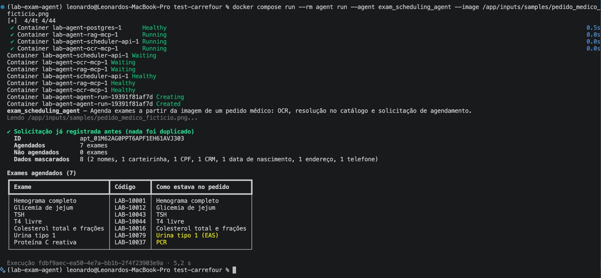

**Revisão humana.** "T4" é ambíguo (T4 livre ou T4 total, ambos com similaridade 0,93). O gate não decide sozinho e pede a escolha ao usuário.

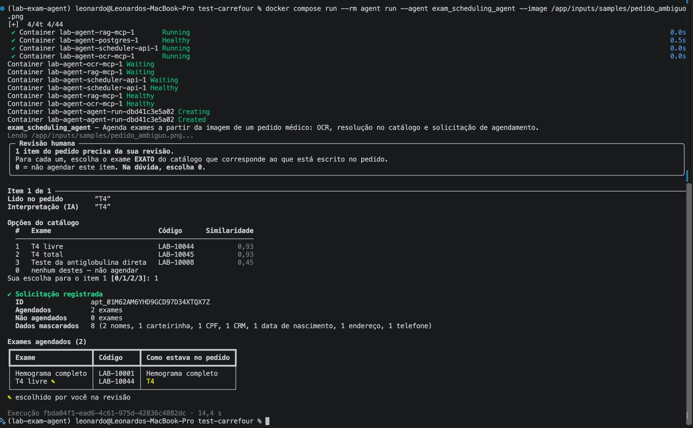

**Prompt injection.** O pedido contém trechos que parecem instruções para a IA. Ele é bloqueado antes do LLM e nada é agendado.

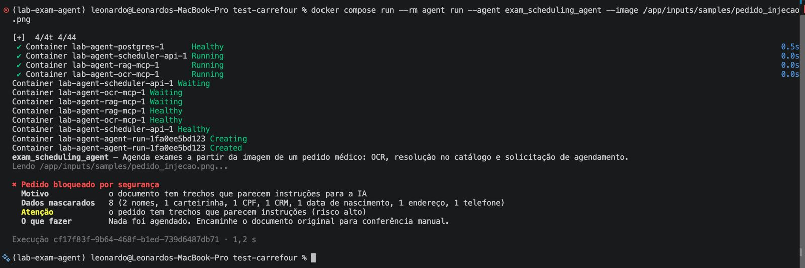

**Pedido manuscrito.** Pedido escrito à mão em papel pautado ([`samples/pedido_manuscrito.jpg`](samples/pedido_manuscrito.jpg)). O OCR leu "TSH" como "15H"; a IA sugeriu TSH e a confirmação veio da revisão humana. "FERRLTINA" foi resolvido para Ferritina. 4 exames agendados, 7 dados pessoais mascarados.

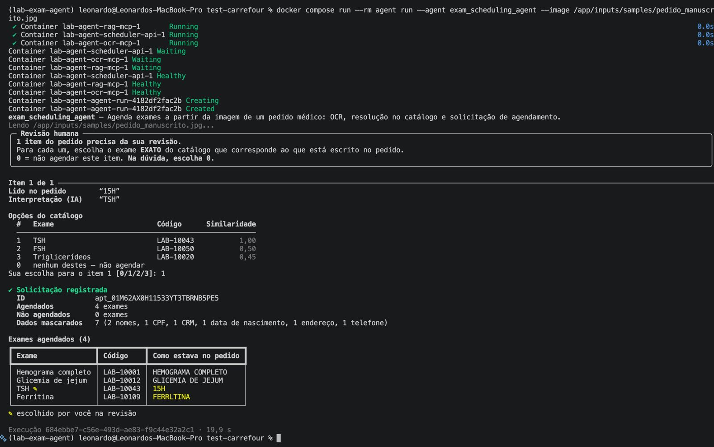

**Pedido manuscrito, segunda execução.** Mesmo com o OCR de um manuscrito, a chave de idempotência se mantém: mesmo `ID`, nada duplicado.

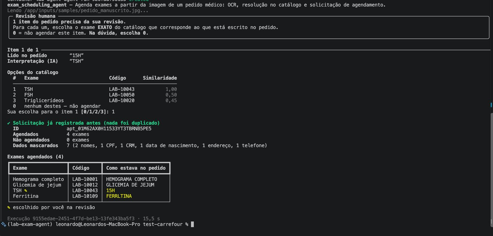

### API

**Swagger.** Rotas de agendamento, catálogo e health, autenticação por `X-API-Key` e contrato sem dados pessoais (só o pseudônimo `patient_ref`).

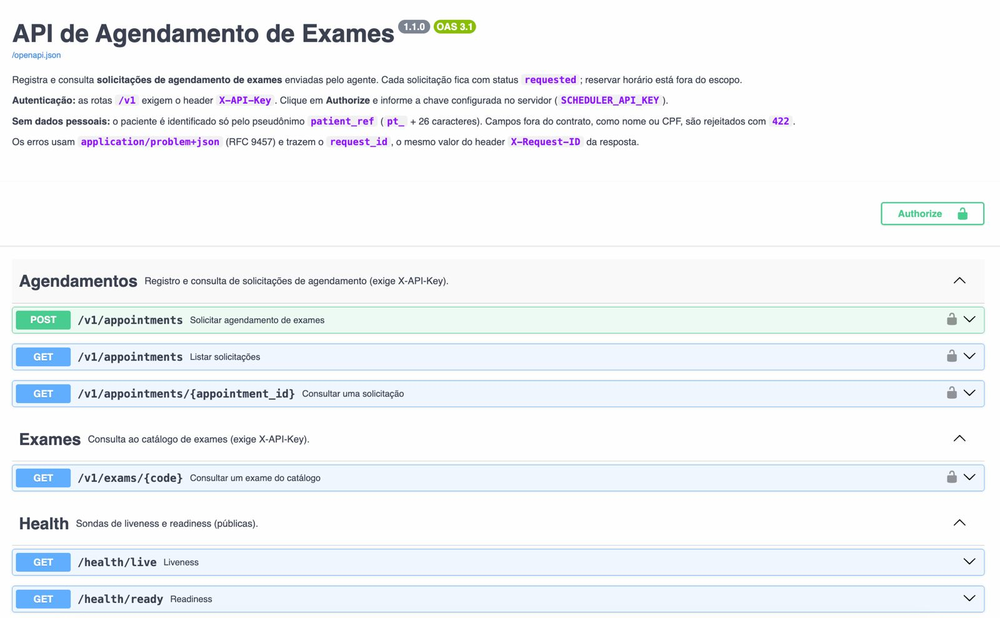

**Consulta dos agendamentos.** `GET /v1/appointments` devolve a solicitação do pedido manuscrito com status `requested`, os códigos do catálogo e o hash do documento de origem.

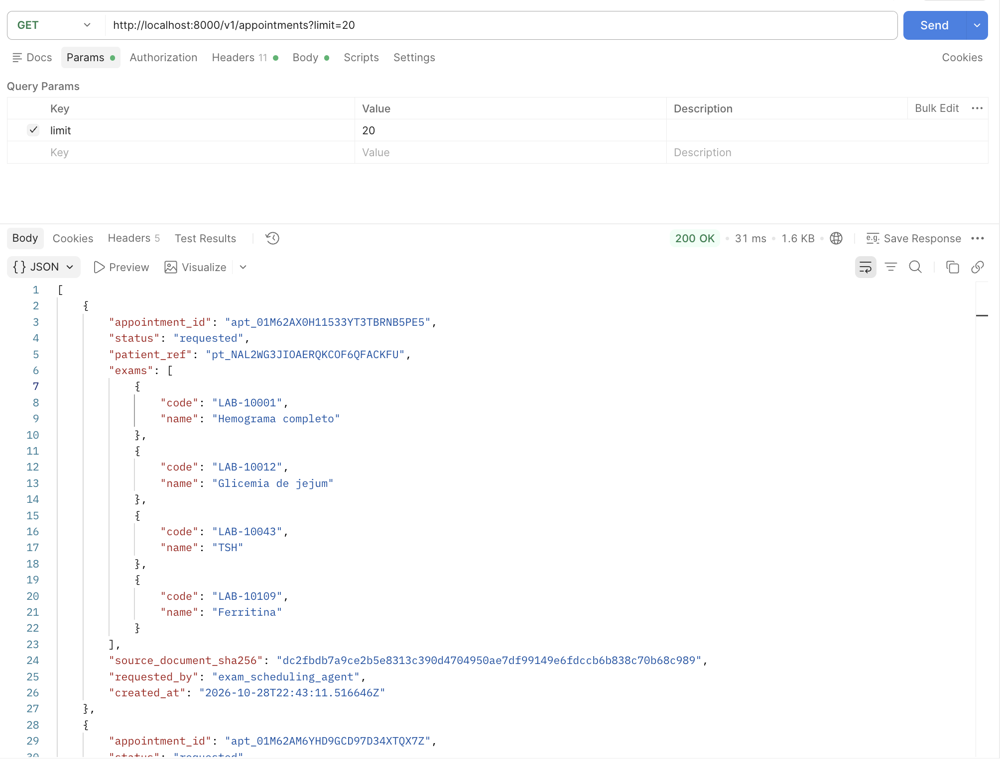

### Logs e traces

**Logs estruturados.** Logs em JSON dos serviços `rag-mcp`, `ocr-mcp` e `scheduler-api` no Aspire Dashboard.

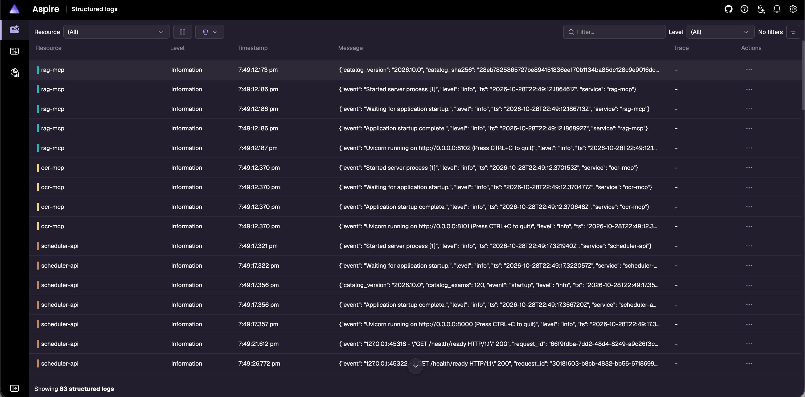

**Trace de uma execução.** Uma execução do agente de ponta a ponta (23 spans, 4 serviços): OCR, guard, extração em paralelo (Gemini e busca léxica), resolve, gate e `POST /v1/appointments`.

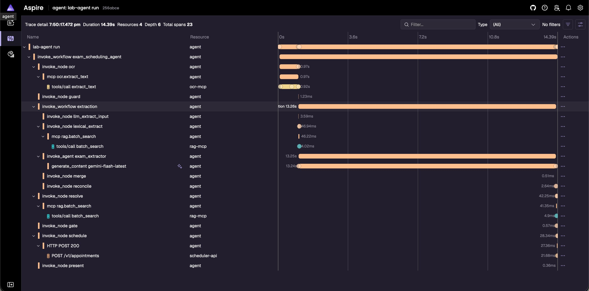

### Docker

**Serviços no ar.** `docker compose ps` com todos os serviços saudáveis. Só a API (8000) e o Aspire (18888) ficam expostos, e só em `127.0.0.1`.

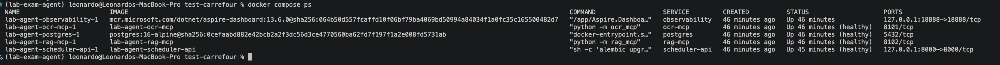

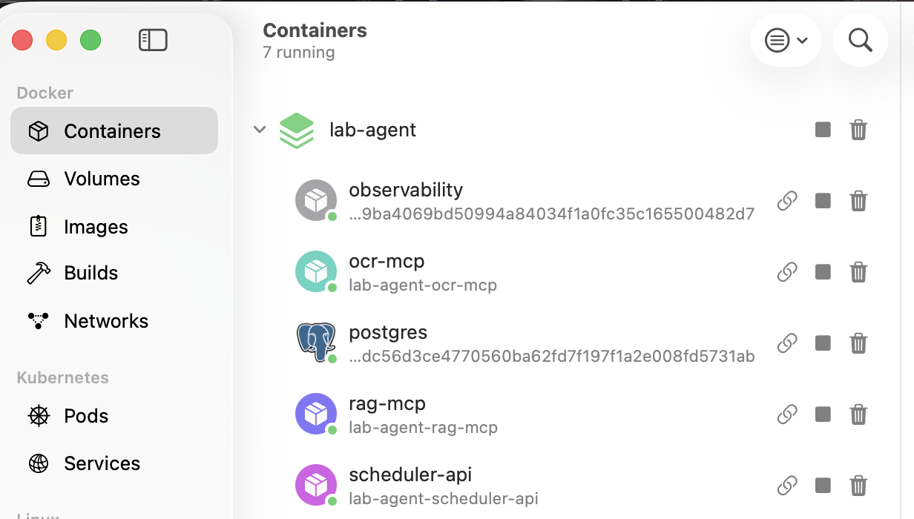

### Testes

**Suíte de testes e cobertura.** 2.102 testes passando, com relatório de cobertura por arquivo.

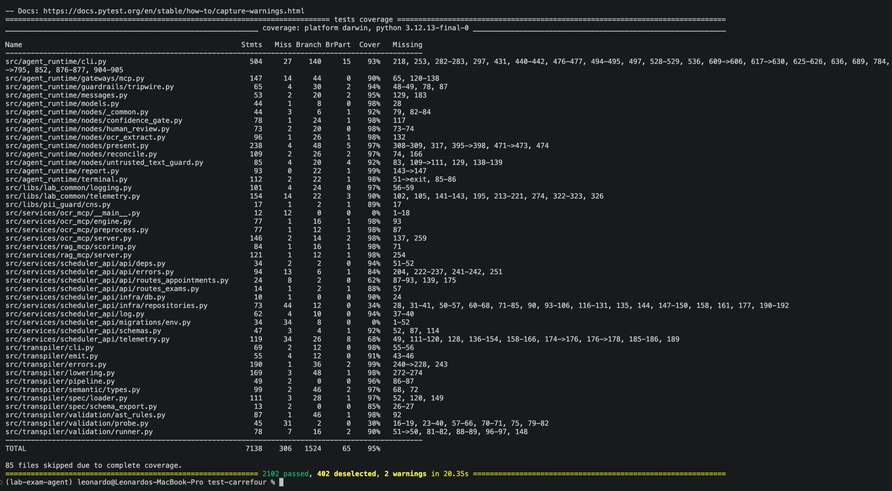

## Uso de IA


