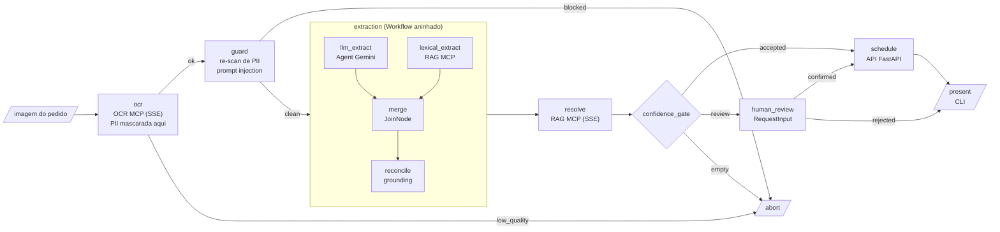

# lab-exam-agent

Transpilador que lê uma especificação JSON de agente e gera um pacote Python com **Google ADK 2**. O agente gerado lê a imagem de um pedido médico fictício, extrai o texto por OCR (servidor MCP via SSE), identifica os exames, resolve os códigos num catálogo (servidor MCP via SSE) e registra a solicitação de agendamento numa API FastAPI. O resultado aparece no terminal.

Tudo roda em Docker Compose, e todos os dados são fictícios.



`llm_extract` e `lexical_extract` rodam em paralelo. Só o primeiro usa LLM; a decisão de agendar é sempre do `confidence_gate`, que é código.

## Sumário

- [Requisitos do desafio](#requisitos-do-desafio)
- [Quickstart](#quickstart)
- [Onde está o Google ADK](#onde-está-o-google-adk)
- [Mapa do código](#mapa-do-código)
- [Transpilador](#transpilador)
- [Servidores MCP](#servidores-mcp)
- [Executando o agente](#executando-o-agente)
- [Segurança](#segurança)
- [Decisões de arquitetura](#decisões-de-arquitetura)
- [Testes](#testes)
- [Limitações e próximos passos](#limitações-e-próximos-passos)
- [Evidências](#evidências)
- [Transparência no uso de IA](#transparência-no-uso-de-ia)

## Requisitos do desafio

A lista completa de evidências, com a origem de cada arquivo, está em [`evidence/README.md`](evidence/README.md).

| Requisito | Onde está | Evidência |
|---|---|---|
| Transpilador JSON → Python ADK | [`src/transpiler/`](src/transpiler/) | [`evidence/transpiler/generate.txt`](evidence/transpiler/generate.txt), [`exam_scheduling_agent.agent.py.txt`](evidence/transpiler/exam_scheduling_agent.agent.py.txt) |
| Código gerado instancia agentes só com Google ADK | template [`agent.py.j2`](src/transpiler/codegen/templates/agent.py.j2), allowlist de imports em [`ast_rules.py`](src/transpiler/validation/ast_rules.py) | [`tests/golden/`](tests/golden/) |
| Validação da spec com mensagens claras | [`src/transpiler/semantic/`](src/transpiler/semantic/), [`errors.py`](src/transpiler/errors.py) | [`evidence/transpiler/validate-errors.txt`](evidence/transpiler/validate-errors.txt) |
| Specs diferentes geram código diferente | [`specs/`](specs/) | [`evidence/transpiler/diff-generated.diff`](evidence/transpiler/diff-generated.diff) |
| Código gerado executável | [`src/agent_runtime/`](src/agent_runtime/) | [`evidence/runs/index.md`](evidence/runs/index.md), [`evidence/cli/07-spec-alterada.txt`](evidence/cli/07-spec-alterada.txt) |
| OCR como servidor MCP via SSE | [`src/ocr_mcp/`](src/ocr_mcp/) | [`evidence/logs/compose.log`](evidence/logs/compose.log) (`ocr_request`, `ocr_done`), [`evidence/cli/05-ilegivel.txt`](evidence/cli/05-ilegivel.txt) |
| RAG como servidor MCP via SSE, ≥ 100 exames | [`src/rag_mcp/`](src/rag_mcp/), [`data/exams_catalog.json`](data/exams_catalog.json) (120 exames) | `catalog_loaded` em [`evidence/logs/compose.log`](evidence/logs/compose.log), [`evidence/rag_calibration.md`](evidence/rag_calibration.md) |
| API FastAPI com Swagger fiel ao contrato | [`src/scheduler_api/`](src/scheduler_api/) | [`evidence/openapi.json`](evidence/openapi.json), [`evidence/api/appointment.json`](evidence/api/appointment.json), [capturas](#evidências) |
| PII mascarada antes do LLM e da persistência | [`src/lab_common/pii/`](src/lab_common/pii/), [`src/ocr_mcp/server.py`](src/ocr_mcp/server.py) | [`evidence/api/database.txt`](evidence/api/database.txt), [`tests/security/test_e2e_pii.py`](tests/security/test_e2e_pii.py) |
| Somente Docker + `docker-compose.yml` | [`docker-compose.yml`](docker-compose.yml), [`docker/`](docker/) | [`evidence/docker.md`](evidence/docker.md) |
| JSON de exemplo e imagem de teste | [`specs/`](specs/), [`samples/`](samples/) | [`samples/expected/`](samples/expected/) |
| Testes | [`tests/`](tests/) | [`evidence/coverage.txt`](evidence/coverage.txt) |
| Transparência no uso de IA | [seção neste README](#transparência-no-uso-de-ia) | — |

Cenários do agente com saída versionada: [fluxo feliz](evidence/cli/01-feliz.txt), [replay idempotente](evidence/cli/02-replay.txt), [prompt injection](evidence/cli/03-injection.txt), [pedido ambíguo](evidence/cli/04-ambiguo.txt), [imagem ilegível](evidence/cli/05-ilegivel.txt), [spec alternativa](evidence/cli/06-spec-alternativa.txt), [spec alterada sem regenerar](evidence/cli/07-spec-alterada.txt).

## Quickstart

Pré-requisitos: Docker com Compose v2.24 ou mais novo (Docker Desktop no Windows e macOS, Docker Engine no Linux) e uma chave do Gemini ([aistudio.google.com/apikey](https://aistudio.google.com/apikey)). Não é preciso Python, uv nem make no host.

Os comandos são os mesmos em bash, zsh e PowerShell, exceto a cópia do `.env`:

```bash
cp .env.example .env              # PowerShell: Copy-Item .env.example .env
# edite o .env e preencha GOOGLE_API_KEY

docker compose up -d --build --wait               # Postgres, API, OCR MCP, RAG MCP
docker compose run --rm transpile                 # spec -> código ADK (volume nomeado)
docker compose run --rm export-generated          # copia o código gerado para ./generated
docker compose run --rm agent run --image /app/inputs/samples/pedido_medico_ficticio.png
```

Saída esperada: uma tabela com 7 exames aceitos, `Agendamento: solicitação registrada — id apt_…` e exit 0. Rodar de novo com a mesma imagem devolve o mesmo id como replay idempotente.

| Mais | Comando |
|---|---|
| Revisão humana (pergunta no terminal) | `docker compose run --rm agent run --image /app/inputs/samples/pedido_ambiguo.png` |
| Prompt injection (bloqueado, exit 3) | `docker compose run --rm agent run --image /app/inputs/samples/pedido_injecao.png` |
| Gerar a spec alternativa | `docker compose run --rm transpile /app/specs/examples/exam_lookup_only.json` |
| Rodar a spec alternativa | `docker compose run --rm agent run --image /app/inputs/samples/pedido_medico_ficticio.png --agent-dir /app/generated/exam_lookup_only --spec /app/specs/examples/exam_lookup_only.json` |
| Swagger | [http://localhost:8000/docs](http://localhost:8000/docs) → **Authorize** com o `SCHEDULER_API_KEY` do `.env` |
| Logs | `docker compose logs -f --tail=100` |
| Derrubar tudo, inclusive volumes | `docker compose --profile "*" down -v` (as aspas são necessárias nos dois shells) |

Os segredos do `.env.example` são valores públicos, válidos só para desenvolvimento local. O próprio arquivo mostra como gerar valores aleatórios. Se mudar o `POSTGRES_PASSWORD` depois do primeiro `up`, recrie o banco com `down -v`.

## Onde está o Google ADK

O ADK aparece em três lugares, e cada um tem um papel:

1. **A spec** ([`specs/exam_scheduling_agent.json`](specs/exam_scheduling_agent.json)) descreve o grafo: nós, rotas, subworkflow, modelo e servidores.
2. **O código gerado** ([`tests/golden/exam_scheduling_agent/agent.py`](tests/golden/exam_scheduling_agent/agent.py), ou `./generated/` depois do `export-generated`) instancia o grafo com classes do ADK. É só fiação: imports, chamadas a factories com literais da spec, arestas e rotas.
3. **Os nós** ([`src/agent_runtime/nodes/`](src/agent_runtime/nodes/)) são as factories que o código gerado chama. Cada uma devolve um nó ADK com a lógica testada uma única vez.

Primitivas usadas:

| Primitiva ADK | Onde | Para quê |
|---|---|---|
| `Workflow` | `root_agent` no código gerado | Grafo raiz com arestas `("START", n)` e rotas `(n, {"rota": m})` |
| `Workflow` aninhado | `extraction` no código gerado | Subworkflow tratado como um nó do grafo raiz |
| `FunctionNode` | [`nodes/_common.py`](src/agent_runtime/nodes/_common.py) | Cada nó determinístico, com `RetryConfig` e `timeout` vindos da spec |
| `Event` com rota | `routed()` em [`nodes/_common.py`](src/agent_runtime/nodes/_common.py) | O nó emite `Event(output=..., actions=EventActions(route="ok"))`; o grafo segue a rota |
| `JoinNode` | `merge` no código gerado | Fan-in do LLM e da extração léxica, que rodam em paralelo |
| `Agent(mode="single_turn", output_schema=...)` | `exam_extractor` no código gerado | Única chamada ao LLM: texto mascarado → `ExtractedExams`, sem tools |
| `before_model_callback` | [`guardrails/tripwire.py`](src/agent_runtime/guardrails/tripwire.py) | Bloqueia a chamada se a requisição ao modelo tiver PII |
| `RequestInput` | [`nodes/human_review.py`](src/agent_runtime/nodes/human_review.py) | Pausa o fluxo para o operador escolher entre candidatos |
| `App` + `ResumabilityConfig` | `app` no código gerado | Permite retomar a invocação depois da revisão humana |
| `Runner` | [`cli.py`](src/agent_runtime/cli.py) | Executa a `App` e faz o resume com a resposta da revisão |

As suposições sobre a API do ADK 2.13.0 viraram testes em [`tests/contract/test_adk_contract.py`](tests/contract/test_adk_contract.py). O primeiro deles falha se a versão do ADK mudar ([ADR-0009](docs/adr/0009-adk-api-contract.md)).

## Mapa do código

| Pacote | Responsabilidade | Requisito |
|---|---|---|
| [`transpiler`](src/transpiler/) | Spec JSON → validação → IR → lowering → geração Jinja2 → validação do código gerado. CLI `lab-transpile`. | Transpilador, validação, código executável |
| [`agent_runtime`](src/agent_runtime/) | Factories dos nós, gateways MCP e HTTP, guardrails (injection, tripwire de PII), modelo fake para testes, CLI `lab-agent`. | Agente ADK, CLI |
| [`ocr_mcp`](src/ocr_mcp/) | Servidor MCP/SSE com a tool `extract_text`: valida a imagem, pré-processa, roda o Tesseract e mascara PII antes de responder. | OCR MCP, PII |
| [`rag_mcp`](src/rag_mcp/) | Servidor MCP/SSE com `search_exams`, `batch_search` e `get_exam` sobre o catálogo: BM25 + trigramas + fuzzy. | RAG MCP |
| [`scheduler_api`](src/scheduler_api/) | API FastAPI de solicitações de agendamento: API key, idempotência, Problem Details, Postgres + Alembic. | API + Swagger |
| [`lab_common`](src/lab_common/) | Código compartilhado sem dependência dos outros pacotes: detectores e redator de PII, logs JSON com redação, contratos OCR/RAG, normalização de texto, regra do gate, auth dos servidores MCP. | PII, contratos |

As fronteiras são verificadas pelo [import-linter](.importlinter): o transpilador não importa o runtime nem o ADK, os servidores não importam uns aos outros e o `lab_common` não importa nenhum pacote do projeto.

## Transpilador

```text
spec JSON → load (tamanho, UTF-8, chaves duplicadas) → schema (Pydantic strict)
          → semântica (grafo, rotas, tipos, refs, segurança) → IR imutável → lowering
          → Jinja2 → validação (AST allowlist, compile, import em subprocesso isolado)
          → pacote gravado de forma atômica + manifesto com o sha256 da spec
```

### Formato da spec

O schema completo está em [`schemas/`](schemas/) (também em `lab-transpile schema`). As seções principais:

| Seção | Conteúdo |
|---|---|
| `agent` | Nome (identificador Python), descrição, versão |
| `models` | Provedor, modelo, temperatura, `max_output_tokens` |
| `mcp_servers` | `transport: "sse"`, variável de ambiente da URL e do token, `allowed_tools`, timeouts |
| `http_services` | Variável da URL base e da API key, timeout |
| `llm_agents` | Modelo, arquivo de instrução, `output_schema`, `tools` (precisa ser vazio), `input_trust` |
| `workflow` / `subworkflows` | Nós (`id`, `kind`, `params`, `retry`, `timeout_s`) e arestas (`from`, `to`, `route`) |
| `policies` | `pii.fail_closed` (obrigatório e `true`) e defaults de retry/timeout |

São 13 *kinds* de nó registrados em [`registry.py`](src/transpiler/registry.py), cada um com rotas, parâmetros e tipos de entrada e saída declarados. Segredos nunca entram na spec: um campo como `api_key` com valor literal gera `E_INLINE_SECRET`.

### Validação

Todos os erros de uma execução são acumulados e mostrados juntos, com código, JSON Pointer, nó e dica. Exit codes: 0 ok, 1 E/S ou uso, 2 schema, 3 semântica, 4 geração. Uma spec com mais de 32 níveis de aninhamento é erro de schema (exit 2), antes de qualquer outra verificação. Exemplo real ([`evidence/transpiler/validate-errors.txt`](evidence/transpiler/validate-errors.txt)), com a spec principal alterada para usar uma tool fora da allowlist, um serviço não declarado e uma aresta que pula o gate:

```text
✖ E_TOOL_NOT_ALLOWED    /workflow/nodes/0/tool  (node "ocr", kind ocr_extract)
  A tool "read_file" não está em mcp_servers.ocr.allowed_tools ['extract_text'].
✖ E_UNKNOWN_REF         /workflow/nodes/6/service  (node "schedule", kind schedule)
  serviço HTTP "payments" não está declarado
  dica: declarados: scheduler
✖ E_SCHEDULE_NOT_GATED  /workflow/nodes/6  (node "schedule", kind schedule)
  existe caminho de START até "schedule" que não passa por confidence_gate
6 erros, 2 avisos. Nenhum arquivo foi gerado.
```

Algumas regras semânticas que vão além do schema:

- **Dominância:** todo caminho até `schedule` passa pelo `confidence_gate`, e todo caminho até o LLM passa pelo `guard`.
- **Rotas exaustivas:** cada rota que um nó pode emitir tem destino.
- **Tipos entre nós:** a saída de um nó precisa ser a entrada que o próximo espera. O `reconcile` precisa receber diretamente um `join` do mesmo grafo, que combine exatamente uma saída do LLM e uma lexical; um join dentro de outro subworkflow é rejeitado com `E_RECONCILE_WITHOUT_JOIN`.
- **Segurança:** agente que lê texto não confiável não pode ter tools, e `fail_closed: false` é rejeitado.
- **Orçamento de tempo:** o timeout do nó não pode ser menor que o timeout de leitura do servidor que ele chama.
- **Ambiguidade visível ao gate:** o `rag_resolve` que alimenta o `confidence_gate` precisa pedir pelo menos 2 candidatos (`top_k >= 2`, senão `E_GATE_CANDIDATES`); com um só, o empate entre "T4 livre" e "T4 total" passaria por aceite.

O corpus de specs inválidas tem um arquivo por código de erro, em [`tests/data/specs/invalid/`](tests/data/specs/invalid/).

### As duas specs

| Spec | Grafo | O que muda no código gerado |
|---|---|---|
| [`exam_scheduling_agent.json`](specs/exam_scheduling_agent.json) | Fluxo completo: OCR, guard, extração híbrida, RAG, gate, revisão humana, agendamento | `Agent` com Gemini, `JoinNode`, `Workflow` aninhado, `human_review`, `schedule`, `App` com `ResumabilityConfig` |
| [`exam_lookup_only.json`](specs/examples/exam_lookup_only.json) | Só identifica os exames: OCR, guard, extração léxica, RAG, gate, apresentação | Sem `Agent`, sem `JoinNode`, sem serviço HTTP, sem revisão nem agendamento; imports mínimos |

O diff entre os dois `agent.py` gerados está em [`evidence/transpiler/diff-generated.diff`](evidence/transpiler/diff-generated.diff). Os dois pacotes são versionados como golden files em [`tests/golden/`](tests/golden/) e comparados byte a byte com a saída do transpilador.

Se a spec mudar e o código não for regenerado, a CLI do agente compara o sha256 do manifesto e sai com exit 7.

## Servidores MCP

Os dois servidores usam o `FastMCP` do SDK oficial `mcp` (série 1.x) com o app SSE (`sse_app()`) servido pelo uvicorn. Sobem com o `docker compose up` e só respondem dentro da rede interna `backend`:

| Servidor | URL interna | Tools | `/health` |
|---|---|---|---|
| `ocr-mcp` | `http://ocr-mcp:8101/sse` | `extract_text` | engine, idioma e versão do Tesseract |
| `rag-mcp` | `http://rag-mcp:8102/sse` | `search_exams`, `batch_search`, `get_exam` + resource `catalog://info` | versão, sha256 e número de exames do catálogo |

Como o agente se conecta:

1. **URLs e token vêm do ambiente.** A spec declara só os nomes das variáveis (`url_env: "OCR_MCP_URL"`, `auth_token_env: "MCP_AUTH_TOKEN"`); o compose as preenche no container do agente.
2. **Bearer token.** Os servidores exigem `Authorization: Bearer <MCP_AUTH_TOKEN>` em todo path, exceto `/health`, com comparação em tempo constante ([`lab_common/mcp_server.py`](src/lab_common/mcp_server.py)). Sem token, a resposta é 401.
3. **Allowlist de tools.** A spec lista `allowed_tools` por servidor. O transpilador rejeita um nó que use tool fora da lista (`E_TOOL_NOT_ALLOWED`) e o gateway do runtime recusa a chamada de novo em tempo de execução.
4. **Gateway.** As tools são chamadas por nós determinísticos, nunca pelo LLM. O padrão é o `SessionMcpGateway` ([`gateways/mcp.py`](src/agent_runtime/gateways/mcp.py)), que usa `mcp.client.sse.sse_client` + `ClientSession.call_tool`, uma conexão por chamada, com os timeouts da spec. Existe também o `AdkMcpGateway`, sobre `McpToolset` + `SseConnectionParams` do ADK (`AGENT_MCP_GATEWAY=adk`). O motivo de o padrão não ser o do ADK está no [ADR-0009](docs/adr/0009-adk-api-contract.md): ele somaria um segundo nível de retry e não distingue um 401 de uma queda de rede.

Para acessar os servidores do host durante o desenvolvimento, o [`docker-compose.dev.yml`](docker-compose.dev.yml) publica as portas 8101 e 8102 (e tira o isolamento, como avisa o arquivo).

## Executando o agente

```text
lab-agent run --image <png|jpeg> [--non-interactive] [--output table|json]
              [--agent-dir DIR] [--spec SPEC] [--run-id UUID]
```

| Opção | Padrão | Efeito |
|---|---|---|
| `--image` | obrigatório | Caminho dentro de `INPUT_ROOT` (`/app/inputs` no container; `samples/` está montado em `/app/inputs/samples`) |
| `--non-interactive` | desligado | Itens que pedem revisão são rejeitados (`needs_human_review`) em vez de perguntar |
| `--output` | o `format` da spec | `table` (rich) ou `json` (relatório completo no stdout) |
| `--agent-dir` / `--spec` | spec principal | Pacote gerado e spec correspondente; usados para a spec alternativa |
| `--run-id` | UUID novo | Correlaciona os logs; a API recebe o mesmo valor como `X-Request-ID` |

Exit codes:

| Código | Significado |
|---|---|
| 0 | Agendado, replay idempotente, ou exames resolvidos (spec sem agendamento) |
| 2 | Entrada inválida (imagem corrompida, formato não aceito) |
| 3 | Bloqueado pelo guard por prompt injection (`INPUT_BLOCKED`) |
| 4 | OCR com qualidade baixa |
| 5 | Nenhum exame aceito (inclusive revisão sem nenhuma escolha) |
| 6 | Dependência falhou (MCP, API, LLM, timeout) ou execução terminou sem pedido de agendamento |
| 7 | Código gerado desatualizado em relação à spec, ou não importável |
| 8 | Configuração inválida (variável faltando, `--agent-dir` fora de `GENERATED_ROOT`) |

**Revisão humana.** Quando o gate manda itens para revisão e a execução é interativa (o padrão; o serviço `agent` do compose tem TTY), a CLI mostra os candidatos do RAG e pede uma escolha. Com `pedido_ambiguo.png`, a pergunta é entre `T4 livre — LAB-10044` e `T4 total — LAB-10045`, ou nenhum. A resposta volta ao fluxo pelo resume do `RequestInput`, e só os códigos escolhidos são agendados.

**Saída JSON.** `--output json` imprime `run_id`, `outcome`, `exit_code`, o caminho percorrido no grafo, tempos por nó, retries, contagens de PII mascarada, severidade de injection, cada exame com menção, código, score e status, e o agendamento (`scheduled` ou `replayed`). Exemplos em [`evidence/runs/`](evidence/runs/).

**Sem chave do Gemini.** O modelo fake existe só para testes: `AGENT_LLM_BACKEND=fake` é recusado se `APP_ENV` não for `test`. O jeito mais simples de ver o fluxo completo sem chave é a suíte E2E (`uv run pytest -m "e2e and not llm" tests/e2e`), que sobe o compose com o override [`docker-compose.e2e.yml`](docker-compose.e2e.yml) e o fake.

## Segurança

**PII.** O texto bruto do OCR só existe dentro do processo `ocr-mcp`:

| Camada | O que faz |
|---|---|
| `ocr-mcp` | Detecta CPF, CNS, RG, telefone, e-mail, CEP, endereço, data de nascimento, CRM, carteirinha e nomes após rótulo (em qualquer caixa, inclusive quando o nome vem na linha seguinte ao rótulo), e devolve só texto com placeholders (`[PESSOA_1]`, `[CPF_1]`). Se o motor de PII falhar ou sobrar resíduo, a tool falha sem texto. |
| `patient_ref` | `pt_` + HMAC-SHA256 do identificador, calculado no `ocr-mcp` com um segredo que só ele recebe. É o único vínculo com o paciente que a API conhece. |
| `guard` | Reescaneia o texto recebido; se ainda houver PII depois de mascarar de novo, a execução para. |
| `before_model_callback` | Escaneia a requisição inteira ao modelo; identificador válido ou parte binária bloqueia a chamada. |
| Logs | Processador do structlog redige valores e remove chaves proibidas em todos os serviços. Os logs das bibliotecas `mcp`, `uvicorn` e `google_adk` perdem o payload. |
| API | O contrato não tem campo para dados pessoais; campos extras são rejeitados com 422. |

Como é provado: [`tests/security/test_e2e_pii.py`](tests/security/test_e2e_pii.py) procura os valores pessoais das amostras e os padrões genéricos nos logs de todos os containers, na saída da CLI, no `pg_dump` do banco, no base64 da imagem e na pasta `evidence/`. [`test_runtime_pii.py`](tests/security/test_runtime_pii.py) faz o mesmo nas requisições ao LLM e nos eventos e no estado da sessão ADK.

**Prompt injection.** O texto do OCR é tratado como dado:

- o `guard` pontua padrões de injection (pt/en, caracteres invisíveis) e bloqueia em severidade alta antes do LLM;
- o documento chega ao modelo entre `<documento_nao_confiavel>`;
- o `Agent` não tem tools e só devolve um schema;
- cada exame do LLM precisa citar um trecho que exista no texto (grounding). Isso prova que o trecho existe, não que o nome devolvido corresponde a ele; por isso o RAG resolve também o trecho, e o nome só é aceito quando os dois apontam para o mesmo código e ambos passam pelo gate. Se divergirem ou se o trecho for ambíguo ("T4"), o item vai para revisão;
- os códigos vêm só do catálogo, pelo RAG.

Essas camadas reduzem o efeito de uma injeção que passe pelo `guard`, mas não o anulam. O modelo ainda pode omitir exames: a extração léxica em paralelo recupera os que estão escritos como no catálogo, não todos. Pode também dar a um trecho o nome de outro exame: a conferência pelo trecho manda esse item para revisão em vez de aceitá-lo. O que ele não consegue é criar um código fora do catálogo, chamar tools ou chegar ao agendamento sem passar pelo gate. Com `pedido_injecao.png`, o fluxo para em `ocr → guard → abort`, sem chamar o LLM nem a API ([`evidence/cli/03-injection.txt`](evidence/cli/03-injection.txt)).

**Autenticação.** A API exige `X-API-Key`, e os MCPs exigem bearer token. Os dois segredos têm pelo menos 32 caracteres e são comparados em tempo constante. Cada container recebe só os segredos que usa: `GOOGLE_API_KEY` só no agente, `PII_HMAC_SECRET` só no OCR.

**Redes e containers.**

- **Redes:** todos os serviços estão na rede `internal` `backend`, sem internet. Só o agente entra na `egress`, para falar com o Gemini. A API entra na `edge` apenas para publicar a porta, e essa rede está sem NAT de saída.
- **Portas:** só `127.0.0.1:8000` é publicada. OCR, RAG e Postgres não têm porta no host.
- **Containers:** raiz read-only, `/tmp` em memória, `cap_drop: ALL`, `no-new-privileges`, UID 10001 e imagens sem binários setuid. O Postgres usa a imagem oficial, com 5 capabilities.
- **Verificação:** [`scripts/check_isolation.sh`](scripts/check_isolation.sh) confere tudo isso com a stack no ar (ferramenta de desenvolvimento e CI, em bash).

**Exceção: `export-generated` roda como root.** O `./generated` do host pertence ao usuário do host, ou a root quando o Docker cria a pasta, e o UID 10001 não consegue gravar nele. Por isso esse container, e só ele, roda como root, restrito a:

- capabilities `CHOWN`, `DAC_OVERRIDE` e `FOWNER`;
- sem rede;
- raiz read-only e volume de origem read-only.

Ele copia o código gerado e passa a posse dos arquivos para o dono de `./specs`, que é quem clonou o repositório.

## Decisões de arquitetura

**O LLM varia, a decisão é determinística.** O Gemini só normaliza menções a partir de texto mascarado. Código do exame, aceitação, roteamento, retries e agendamento são decididos por código. Nas execuções reais, o nome que o modelo devolve muda: para a linha "TSH" do pedido, ele já devolveu "Hormônio tireoestimulante (TSH)" e "TSH (Hormônio tireoestimulante)"; para "Urina tipo 1 (EAS)", "Urina tipo 1", "Exame de urina tipo 1 (EAS)" e "EAS (Elementos Anormais e Sedimento)". Em todas as execuções registradas, o resultado final foi o mesmo: os 7 códigos de [`samples/expected/`](samples/expected/pedido_medico_ficticio.json) e o mesmo agendamento. Uma variante que pontua abaixo do limiar, ou cujo trecho aponta para outro exame, vai para revisão ou é rejeitada, e o item léxico do mesmo trecho garante o código ([`evidence/cli/01-feliz.txt`](evidence/cli/01-feliz.txt) mostra os dois casos).

| ADR | Decisão |
|---|---|
| [0001](docs/adr/0001-workflow-em-grafo-adk.md) | Workflow em grafo do ADK 2 com rotas explícitas; LLM num único nó, sem tools |
| [0002](docs/adr/0002-codigo-gerado-como-composicao.md) | Código gerado só compõe factories de `agent_runtime`; lógica testada uma vez |
| [0003](docs/adr/0003-pii-mascarada-na-origem.md) | PII mascarada no servidor OCR, com verificações independentes depois |
| [0004](docs/adr/0004-mcp-chamado-por-nos-deterministicos.md) | Tools MCP chamadas por nós determinísticos, nunca pelo LLM |
| [0005](docs/adr/0005-rag-lexico-hibrido.md) | BM25 + trigramas + fuzzy, com thresholds calibrados num conjunto de avaliação |
| [0006](docs/adr/0006-idempotencia-por-chave-deterministica.md) | `Idempotency-Key` derivada do conteúdo + chave primária no Postgres |
| [0007](docs/adr/0007-sse-como-transporte-mcp.md) | SSE (exigido pelo desafio) isolado atrás do gateway; `mcp<2` |
| [0008](docs/adr/0008-ocr-local-tesseract.md) | OCR local com Tesseract em vez de LLM multimodal (a imagem tem PII) |
| [0009](docs/adr/0009-adk-api-contract.md) | Contrato com a API do `google-adk` 2.13.0, fixado em testes |

Thresholds do gate (0,85 / 0,60 / margem 0,05): calibrados em 104 consultas rotuladas, com 100% de precisão nos aceitos e nenhum negativo aceito ([`evidence/rag_calibration.md`](evidence/rag_calibration.md)).

## Testes

| Camada | Marker | O que cobre | Precisa de |
|---|---|---|---|
| Unitários | `unit` | Cada módulo, com hypothesis onde há espaço de entrada grande | — |
| Contrato | `contract` | API do ADK, registry ↔ factories, cliente ↔ `openapi.json` | — |
| Integração | `integration` | Postgres real, servidores MCP via SSE, Tesseract, workflow com fake LLM | Docker, Tesseract |
| Segurança | `security` | Vazamento de PII, injeção de código pela spec, prompt injection, auth | Docker, Tesseract |
| E2E | `e2e` | Compose completo, CLI no container, verificação na API e no banco | Docker |
| LLM real | `llm` | Fluxo feliz com Gemini (manual, `workflow_dispatch` no CI) | `GOOGLE_API_KEY` |

Comandos (ambiente de desenvolvimento com [uv](https://docs.astral.sh/uv/)):

```bash
uv sync --all-extras --group dev && uv run pre-commit install
uv run pre-commit run --all-files && uv run pytest -m "unit or contract"   # check de desenvolvimento
uv run pytest -m "(integration or security) and not e2e"                   # Docker e Tesseract
uv run pytest -m "e2e and not llm" tests/e2e tests/security/test_e2e_pii.py
uv run pytest -m "e2e and llm" tests/e2e                                   # Gemini real
bash scripts/check_isolation.sh                                            # com a stack no ar
```

O pre-commit roda ruff, ruff format, mypy (strict em `transpiler`, `lab_common` e `agent_runtime`) e import-linter.

**Cobertura atual: 98%** em todos os testes menos os E2E (2185 testes, [`evidence/coverage.txt`](evidence/coverage.txt)). O check de desenvolvimento roda 1840 testes, e a suíte E2E, 18. O CI ([`.github/workflows/ci.yml`](.github/workflows/ci.yml)) roda qualidade, unit/contract, integração/segurança e E2E; o job com Gemini real é manual.

## Limitações e próximos passos

Limitações conhecidas:

- **Manuscrito:** o Tesseract lê bem pedidos impressos. Manuscrito e fotos ruins tendem a cair em `OCR_LOW_QUALITY` (exit 4) em vez de seguir com texto ruim.
- **Nomes sem rótulo:** o detector de nomes depende de rótulos ("Paciente:", "Dr."). Um nome solto no texto pode escapar. Identificadores com dígito verificador (CPF, CNS) não dependem disso.
- **Excesso de mascaramento:** o endereço do laboratório também é mascarado, porque o detector não sabe de quem é o endereço.
- **Aliases curtos:** com erro de OCR, "Ferritlna" pode ter o alias "Na" (Sódio) como primeiro candidato. O score fica abaixo do limiar, então não há aceite errado, mas a revisão mostra o exame certo em segundo.
- **SSE é o transporte legado do MCP:** foi exigido pelo desafio. O recomendado hoje é Streamable HTTP.
- **Migração no entrypoint da API:** o `alembic upgrade head` roda na subida do container, o que não serve com várias réplicas.
- **Nome fixo do projeto Compose (`lab-agent`):** duas cópias do repositório na mesma máquina compartilham containers e volumes.

Próximos passos para produção:

- MCP via Streamable HTTP e `mcp` 2.x, mudança restrita aos servidores e ao gateway ([ADR-0007](docs/adr/0007-sse-como-transporte-mcp.md));
- mTLS entre serviços e segredos num cofre, com rotação;
- NER como detector de PII adicional;
- fila para o OCR, com limite de concorrência por worker;
- migração como job separado do deploy;
- tracing (OpenTelemetry) além dos logs correlacionados por `run_id`;
- LGPD: política de retenção e expurgo das chaves de idempotência, e base legal e DPO definidos.

## Evidências

Capturas tiradas à mão; a preparação está em [`evidence/screenshots/README.md`](evidence/screenshots/README.md).

**Swagger**


**CLI**


## Transparência no uso de IA

**Como usei.** Antes de escrever código, planejei o projeto em documentos: contexto e requisitos, arquitetura, segurança, um documento por componente, estratégia de testes, um plano de 80 commits dividido em 9 fases e um checklist de revisão. Usei um assistente de IA para implementar esse plano, uma fase por vez, em commits pequenos. Cada commit só entrava com o check de desenvolvimento verde. No fim de cada fase, o assistente entregava um relatório com o que foi feito, os desvios do plano, as decisões que eu precisava revisar e as dúvidas em aberto. Eu revisava o relatório e o código, aprovava ou pedia correções, e só então criava a tag da fase (`phase-01` a `phase-08`). As correções pedidas na revisão viraram commits próprios (os sufixos `a`, `b`, `c` no histórico), sem reescrever commits já feitos.

**O que a revisão pegou.** Exemplos reais, todos no histórico:

- **`mcp<2`.** Na série 2.x do SDK `mcp`, a classe `FastMCP` deixou de existir, embora o `google-adk` aceite `mcp<3`. Verificamos com a 2.3.0 e fixamos `mcp>=1.24,<2` ([ADR-0007](docs/adr/0007-sse-como-transporte-mcp.md)).
- **Base64 da imagem nos logs da biblioteca `mcp`.** Três caminhos da biblioteca logavam trechos do corpo da requisição quando o JSON-RPC era malformado. O filtro de logs passou a cortar o payload de qualquer registro dessas bibliotecas, e um teste envia requisições malformadas e procura o base64 no log (`b793d33`).
- **Detectores de PII casando dentro de hashes.** Em 80 mil UUIDs e sha256 aleatórios, os detectores achavam 5339 "telefones", "CPFs" e "CEPs". O sha256 do catálogo saía adulterado no log. Corrigido na base dos detectores e garantido por hypothesis: zero achados (`60fdb1b`).
- **Stopword apagando "Vitamina E".** A normalização removia o "e" final, e "Vitamina E" virava "vitamina", empatada com as vitaminas C e D. A letra final passou a ser mantida, e a recalibração não mudou os thresholds (`468074b`).
- **"MG" lido como Magnésio.** Ao liberar segmentos de 2 caracteres na extração léxica (para pegar "T4"), o "MG" de "Belo Horizonte, MG" seria alias exato de Magnésio, com score 1,0, e seria agendado. O mínimo de 2 caracteres ficou restrito a itens de lista (`d9409b6`).
- **`make` trocado por `docker compose`.** O primeiro caminho do avaliador usava um Makefile. Na revisão, padronizei tudo em `docker compose` (avaliador) e `uv` (desenvolvimento), para que o mesmo comando funcione em Windows, macOS e Linux sem make nem Python no host (`9ae641a`, `40b91f0`).
- **Código gerado em volume nomeado.** Na simulação do avaliador, o bind mount de `./generated` funcionava no macOS, mas no Docker Engine do Linux o UID 10001 não conseguiria gravar nele. Isso levou ao volume nomeado e ao serviço `export-generated` (`5ebb95f`, `0afa0fd`).
- **Achados dos próprios testes.** O teste do catálogo mostrou que "Anti-HAV IgM" era mascarado como nome de pessoa (`57094f2`). O teste de injection no fluxo mostrou que um item do LLM chamado "LAB-10099" conseguia esconder o "Hemograma completo" da extração léxica (`081a5d7`). A primeira chamada real ao Gemini mostrou que a API rejeita `additionalProperties` no schema de resposta (`829a693`).
- **Falhas de processo, registradas como tal.** Dois commits entraram com o check vermelho: um por validar com `make check | tail && git commit` (o `&&` olhou o exit do `tail`) e outro por encadear com `;`. Nenhum foi reescrito; o segundo foi corrigido num commit que cita o original (`e5778ca`), e o fluxo de commit passou a exigir o check com `&&` e sem pipe.

**Auditoria independente antes da entrega.** Uma revisão independente do projeto, com o PDF do desafio como fonte de verdade, encontrou seis falhas que a suíte não cobria, cada uma com arquivo, linha e contraexemplo. Concordei com todas. Cada correção começou por um teste que reproduzia o contraexemplo e falhava, e entrou num commit próprio:

| Achado | Falha | Correção |
|---|---|---|
| F01 (alto) | Nome rotulado em minúsculas, em caixa mista ou na linha seguinte ao rótulo ("Paciente: maria fictícia da silva") escapava do mascaramento e chegava ao modelo e à sessão. | O valor de campos pessoais rotulados é mascarado em qualquer caixa, até o próximo campo; teste com OCR real numa imagem fictícia nova (`1160601`). |
| F02 (alto) | O grounding só provava que o trecho existia: "Ferritina" com evidência "Hemograma completo" era aceita, e a evidência do pedido ambíguo mostrava "T4 total" aceito a partir de "T4". | O RAG resolve também o trecho; o nome aceito pelo gate só continua aceito se a evidência tiver o mesmo top-1, com score >= `review_threshold` e sem empate pela margem; senão vai para revisão (`03b95b7`). Assim um erro de OCR no trecho ("Trigliceríideos") não manda o exame para revisão. |
| F03 (médio) | Com `top_k: 1` no `rag_resolve`, o gate não via o empate de "T4" e aceitava um dos dois. | `E_GATE_CANDIDATES`: o transpilador exige `top_k >= 2` antes do gate (`7f865e7`). |
| F04 (médio) | O cliente da API confirmava um 201 só com `appointment_id`, com `status` errado ou de outro paciente, hash ou exames. | O corpo é validado inteiro e conferido contra a requisição; qualquer divergência é `SCHEDULER_UNEXPECTED_RESPONSE` (`780339c`). |
| F05 (médio) | `reconcile` depois de um subworkflow com o join passava na semântica e derrubava o lowering com `StopIteration`. | `E_RECONCILE_WITHOUT_JOIN`, com JSON Pointer e exit 3 (`9b39f56`). |
| F06 (baixo) | Um JSON de 2 KB com listas aninhadas terminava em `RecursionError` (exit 1). | Limite de 32 níveis e travessia sem recursão; erro de schema, exit 2 (`9139b9d`). |

A auditoria também apontou duas afirmações deste README como excessivas, ajustadas na seção de segurança: o "pior caso" de uma injeção e o que o grounding garante. E mostrou que a captura do pedido ambíguo e o relatório JSON do mesmo cenário vinham de execuções diferentes; o coletor passou a tirar os dois de uma única execução.

**Referências consultadas.**

- Documentação do Google ADK em [adk.dev](https://adk.dev): Graph Workflows, Agents, MCP tools, Callbacks.
- [Especificação do MCP](https://modelcontextprotocol.io) e o [SDK Python](https://github.com/modelcontextprotocol/python-sdk).
- Documentação do [FastAPI](https://fastapi.tiangolo.com), do [SQLAlchemy](https://docs.sqlalchemy.org) e do [Tesseract](https://tesseract-ocr.github.io).
- [OWASP Top 10 for LLM Applications](https://genai.owasp.org/llm-top-10/).
- [RFC 9457](https://www.rfc-editor.org/rfc/rfc9457) (Problem Details for HTTP APIs).

Onde a documentação do ADK 2 não estabilizava um comportamento, a referência final foi a versão instalada: cada suposição virou um teste de contrato ([ADR-0009](docs/adr/0009-adk-api-contract.md)).

**Estratégia de orquestração.**

- **Workflow em grafo determinístico** do ADK 2.
- **Roteamento condicional** por rotas emitidas por código (`ok`, `blocked`, `accepted`, `review`, ...).
- **Fan-out/fan-in:** LLM e extração léxica rodam em paralelo e se juntam num `JoinNode`.
- **Subworkflow** aninhado para a extração.
- **Human-in-the-loop** com `RequestInput` para itens ambíguos.

Não há delegação autônoma entre agentes. O único agente LLM não tem ferramentas, não escolhe o próximo passo e não decide o que é agendado. Foi uma decisão de segurança: o texto que ele lê vem de um documento que não controlamos.
